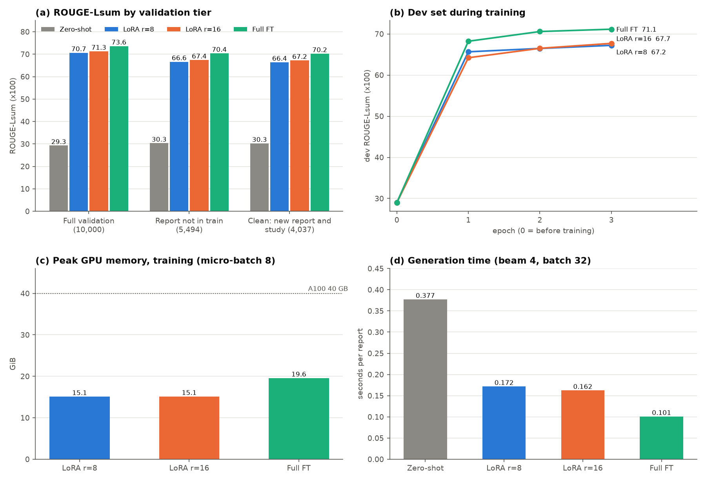

# Radiology Lay Summariser

A research prototype that drafts a plain-language summary of a chest X-ray report for a
clinician to review, and points out where the draft may have lost a negation, lost the
report's degree of certainty, or missed the end of a long report.

> **Status: work in progress.** The writer is trained and evaluated, the review flags are
> measured, and the app runs locally and in Docker; the hosted demo and the manual audit of
> the flags are next.
>
> **Research use only.** Not a medical device and not for diagnosis or patient care.
> Do not paste reports that contain personal information.

## Run it

```bash
git clone https://github.com/BrianTr9/Radiology-Lay-Summariser.git && cd Radiology-Lay-Summariser
pip install -e .        # Python 3.12; or: docker build -t laysum .
python app.py           # or: docker run -p 7860:7860 laysum
```

Open http://localhost:7860. The first run downloads the base model `google/flan-t5-base`
(about 1 GB, pinned to one commit); the adapter ships in this repository. No account or
token is needed. On Linux without a GPU, run
`pip install --index-url https://download.pytorch.org/whl/cpu torch==2.13.0` first: plain
`pip` installs the CUDA build of torch there (about 5 GB with its libraries). The same
function is an API:

```python
from gradio_client import Client
Client("http://localhost:7860").predict("Cardiomegaly. No pneumothorax.", api_name="/summarize")
# {"summary": "...", "decision": "PASS" | "REVIEW", "flags": [...], "meta": {...}}
```

## How it works

```
report ─► writer: FLAN-T5-base + LoRA (r = 16) ─► rule-based flags ─► PASS | REVIEW
```

- **Writer.** FLAN-T5-base (248M parameters) fine-tuned with LoRA on 150k report and
  lay-summary pairs; only 0.7% of the parameters are trained.
- **Flags.** `INPUT_TRUNCATED` (the report is longer than the 512 tokens the writer reads),
  `NEGATION_LOST` and `CERTAINTY_LOST` (the draft has fewer negated or hedged sentences
  than the report). Any flag sends the draft to REVIEW. The rules need no model, so each
  flag points at the exact report sentences it is about.
- **Not covered.** The flags cannot detect content the draft adds that is not in the
  report. A neural grounding checker was tested for this in a small test with criteria
  fixed in advance, and rejected: it could not tell a correct plain-language paraphrase
  from an error.

## Results so far



- The official validation split shares 45% of its reports with training, so the writer
  is also scored on a **clean tier** (4,037 rows whose report and imaging study never
  appear in training). On that tier LoRA reaches ROUGE-Lsum 67.2, against 30.3 zero-shot
  and 70.2 for full fine-tuning.
- On the clean tier the flags send **6.8%** of the LoRA drafts to REVIEW
  ([`eval/results/review_rate.json`](eval/results/review_rate.json)). Whether those flags
  are right is measured next, by reading a seeded sample by hand.

## Repository layout

| Path | Contents |
|---|---|
| `models/lora_r16/` | The trained LoRA adapter (7.1 MB) and its [model card](models/lora_r16/README.md) |
| `training/` | Data loading, LoRA and full fine-tuning, evaluation tiers, Slurm scripts |
| `app.py`, `Dockerfile` | The Gradio app (review screen and `summarize` API) and its CPU image |
| `src/laysum/` | The product code: `writer.py`, `checks.py`, `pipeline.py`, and the self-written `examples.py` |
| `eval/` | Scripts that produce every number in this README |
| `tests/` | Unit tests with a fake writer; `LAYSUM_GOLDEN=1` also runs the real model on the examples |

## Data

[BioLaySumm 2025 LaymanRRG, open-source track](https://huggingface.co/datasets/BioLaySumm/BioLaySumm2025-LaymanRRG-opensource-track):
reports from PadChest ([Bustos et al., 2020](https://arxiv.org/abs/1901.07441)),
BIMCV-COVID19+ ([de la Iglesia Vayá et al., 2020](https://arxiv.org/abs/2006.01174)) and
Open-i, with lay summaries written by GPT-4o. The source datasets forbid redistribution,
so **no report, summary or excerpt from the data is stored in this repository**; scripts
download the data from the Hugging Face Hub when run.

## License

Code: [MIT](LICENSE). The adapter weights in `models/` are for research use only, following
the terms of the data they were trained on. The base model is downloaded from the Hugging
Face Hub at a pinned commit.

## AI assistance

Parts of the code and documentation were drafted with Claude Code and reviewed by the
author.
