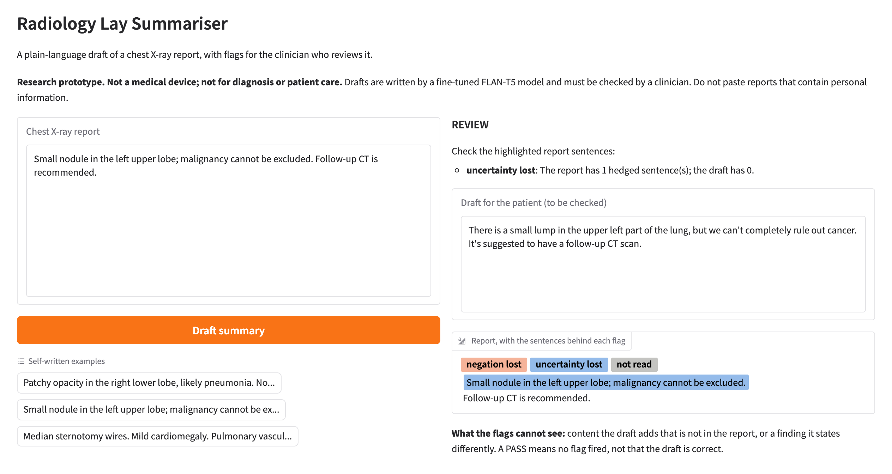

# Radiology Lay Summariser

[](https://github.com/BrianTr9/Radiology-Lay-Summariser/actions/workflows/ci.yml)
[](https://huggingface.co/spaces/BrianTr9/radiology-lay-summariser)

A research prototype that drafts a plain-language summary of a chest X-ray report for a
clinician to check, and sends the draft to **REVIEW** when it may have lost a negation, lost
the report's uncertainty, or missed the end of a long report.

**[Try the demo](https://huggingface.co/spaces/BrianTr9/radiology-lay-summariser)** (Hugging
Face ZeroGPU; signed-in visitors get more GPU time) · or run it locally with the three
commands below.

> **Research use only.** Not a medical device and not for diagnosis or patient care.
> Do not paste reports that contain personal information.



*The screen shows a flag doing its job and its limit at once. The draft keeps the
uncertainty ("we can't completely rule out cancer"), but in words the rule's list does not
know, so the flag is a reason to look, not proof of an error.*

## How it works

```
report ─► writer: FLAN-T5-base + LoRA (r = 16) ─► rule-based flags ─► PASS | REVIEW
```

- **Writer.** FLAN-T5-base (248M parameters) fine-tuned with LoRA on 150k report and
  lay-summary pairs; 0.7% of the parameters are trained. The adapter is merged at load time.
- **Flags.** `INPUT_TRUNCATED` (the report is longer than the 512 tokens the writer reads),
  `NEGATION_LOST` and `CERTAINTY_LOST` (the draft has fewer negated or hedged sentences than
  the report). Any flag sends the draft to REVIEW, and each flag points at the report
  sentences it is about. The rules need no model.
- **What the flags cannot see:** content the draft adds that is not in the report, or a
  finding it states differently. A PASS means no flag fired, not that the draft is correct.

## Run it

On Linux without a GPU, first run
`pip install --index-url https://download.pytorch.org/whl/cpu torch==2.13.0`: plain `pip`
installs the CUDA build of torch there (about 5 GB with its libraries). Then:

```bash
git clone https://github.com/BrianTr9/Radiology-Lay-Summariser.git && cd Radiology-Lay-Summariser
pip install -e .        # Python 3.12; or: docker build -t laysum .
python app.py           # or: docker run -p 7860:7860 laysum
```

Open http://localhost:7860. The first run downloads the base model `google/flan-t5-base`
(about 1 GB, pinned to one commit); the adapter ships in this repository. No account or
token is needed. The same function is an API:

```python
from gradio_client import Client
Client("http://localhost:7860").predict("Cardiomegaly. No pneumothorax.", api_name="/summarize")
# {"summary": "...", "decision": "PASS" | "REVIEW", "flags": [...], "meta": {...}}
```

`pytest` runs the unit tests; `LAYSUM_GOLDEN=1 pytest` also runs the real model on eight
self-written reports with known decisions.

## Results

All numbers are on the official validation split of BioLaySumm 2025 LaymanRRG. Its reports
overlap the training data by 45%, so the writer is also scored on a **clean tier**: 4,037
reports whose text and imaging study never appear in training.

**Writer** ([`training/results/`](training/results)): ROUGE-Lsum

| | All validation (10,000) | Report not in training (5,494) | Clean tier (4,037) |
|---|---|---|---|
| Zero-shot FLAN-T5-base | 29.3 | 30.3 | 30.3 |
| **LoRA r = 16 (this app)** | **71.3** | **67.4** | **67.2** |
| Full fine-tuning | 73.6 | 70.4 | 70.2 |

LoRA comes within 3 points of full fine-tuning on the clean tier while training 0.7% of the
weights, and ships as a 7 MB adapter. Reading level (Flesch-Kincaid grade) falls from 14.4
for the reports to 7.5 for the drafts. The app merges the adapter and drafts one report at a
time; on 200 validation reports it reproduces the measured run (180 drafts identical word
for word, ROUGE-Lsum 70.63 against 70.55; [`eval/results/equivalence.json`](eval/results/equivalence.json)).

**Review gate** ([`eval/results/audit.json`](eval/results/audit.json)): an audit of 200
seeded clean-tier drafts, 100 sent to REVIEW and 100 passed, read one by one against the
source report by an AI model (Claude) following a guide written before reading
([`eval/audit_guide.md`](eval/audit_guide.md)). The rater is not a clinician and there is no
second rater.

| | Value (95% Wilson interval) |
|---|---|
| Drafts sent to REVIEW | 6.8% (274 of 4,037) |
| REVIEW drafts with a significant error | 18% [12–27%] |
| PASS drafts with a significant error | 1% [0.2–5%] |
| Flags that name the right problem | 14% [9–22%] |

The gate concentrates the significant errors: a REVIEW draft is about 18 times as likely to
carry one as a passed draft. Individual flags, though, are mostly false alarms: drafts often
keep a negation or hedge in words the lists do not know ("appears normal", "suggesting") or
merge sentences. The significant errors found include a fatty liver described as swollen, a
postoperative fluid collection attributed to cancer, and a possible infection reported as
absent. Passed drafts carry some error in 37% of cases, almost all minor; the most common is
a negative finding broadened, such as no consolidation written as no pneumonia.

**Speed** ([`eval/results/latency.json`](eval/results/latency.json)): 2.2 s per report (p50,
3.0 s p95) in the Docker image on 4 CPU cores; reports past the 512-token limit take longer.


## Design choices

- **Rules instead of a neural checker.** An NLI hallucination detector (HHEM) was tested
  first, with pass criteria fixed in advance, and rejected: it scored correct plain-language
  paraphrases as unsupported and a dropped "likely" as supported.
- **Three evaluation tiers, no leaderboard claims.** The validation split overlaps training,
  and the shared task's test references are not public, so nothing here is a test-set result.
- **Sentence-level counting.** Fixed before measuring: count cue sentences unless that sends
  more than 25% of drafts outside the clean tier to REVIEW; it sent 2.5%.
- **The adapter lives in the repository.** At 7 MB it needs no model hub, and the app
  refuses to load an adapter whose SHA-256 differs from the one evaluated.

## Repository layout

| Path | Contents |
|---|---|
| `app.py`, `Dockerfile` | The Gradio app (review screen and `summarize` API) and its CPU image |
| `.github/` | CI/CD: lint, tests and a Docker check on every push; on `main`, once both pass, `deploy_space.py` uploads the app to the Space, waits for it to run the new commit, then checks that its API gives the expected decision on a self-written report |
| `src/laysum/` | `writer.py`, `checks.py`, `pipeline.py`, and the self-written `examples.py` |
| `models/lora_r16/` | The trained LoRA adapter and its [model card](models/lora_r16/README.md) |
| `training/` | Data loading, LoRA and full fine-tuning, evaluation tiers, Slurm scripts; `results/` holds each run's metrics (their `git.commit` predates a history rewrite that removed data excerpts) |
| `eval/` | The scripts behind every number above, and their outputs in `results/` (no data text) |
| `tests/` | Unit tests with a fake writer, and the golden tests |

## Data

[BioLaySumm 2025 LaymanRRG, open-source track](https://huggingface.co/datasets/BioLaySumm/BioLaySumm2025-LaymanRRG-opensource-track):
reports from PadChest ([Bustos et al., 2020](https://arxiv.org/abs/1901.07441)),
BIMCV-COVID19+ ([de la Iglesia Vayá et al., 2020](https://arxiv.org/abs/2006.01174)) and
Open-i, with lay summaries written by GPT-4o. The source datasets forbid redistribution,
so **no report, summary or excerpt from the data is stored in this repository**; scripts
download the data from the Hugging Face Hub when run, and every example in the app and
tests is self-written.

## License

Code: [MIT](LICENSE). The adapter weights in `models/` are for research use only, following
the terms of the data they were trained on. The base model is downloaded from the Hugging
Face Hub at a pinned commit.

## AI assistance

Parts of the code and documentation were drafted with Claude Code and reviewed by the
author. The audit labels were assigned by Claude, as described above.
